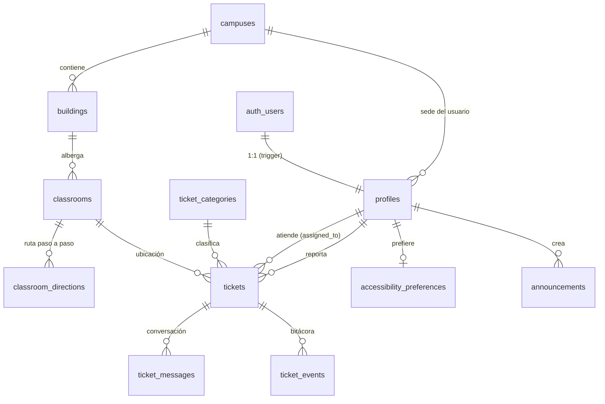

# Base de datos · Camino UTP

Documentación técnica del esquema PostgreSQL desplegado en Supabase para la Etapa 3.

- **Proyecto Supabase:** `camino-utp` (`zsenvmnasrelqsclcrmd`)
- **Motor:** PostgreSQL 17
- **Migraciones:** `supabase/migrations/` (9 archivos, orden cronológico)
- **Autenticación:** Supabase Auth (correo + contraseña). Las contraseñas nunca se guardan en tablas propias.
- **Seguridad:** RLS activo en todas las tablas del esquema `public`.

> Convención: los identificadores son `uuid` generados con `gen_random_uuid()`; las fechas son
> `timestamptz`; todos los catálogos tienen `created_at` y `updated_at` mantenidos por trigger.

---

## 1. Modelo de datos



### Relaciones clave

| Relación | Cardinalidad | Regla de borrado |
|---|---|---|
| `auth.users` → `profiles` | 1 : 1 | `cascade` (al eliminar la cuenta) |
| `campuses` → `buildings` | 1 : N | `restrict` |
| `buildings` → `classrooms` | 1 : N | `restrict` |
| `classrooms` → `classroom_directions` | 1 : N | `cascade` |
| `profiles` → `tickets` (`student_id`) | 1 : N | `cascade` |
| `ticket_categories` → `tickets` | 1 : N | `restrict` |
| `classrooms` → `tickets` | 1 : N | `set null` |
| `profiles` → `tickets` (`assigned_to`) | 1 : N | `set null` |
| `tickets` → `ticket_messages` | 1 : N | `cascade` |
| `tickets` → `ticket_events` | 1 : N | `cascade` |
| `profiles` → `accessibility_preferences` | 1 : 1 | `cascade` |

---

## 2. Tablas

### Catálogo del campus (lectura pública)

| Tabla | Columnas principales | Restricciones |
|---|---|---|
| `campuses` | `id`, `code`, `name`, `city`, `address`, `timezone` | `code` único (`^[A-Z0-9-]{2,12}$`) |
| `buildings` | `id`, `campus_id`, `code`, `name`, `floors` | único `(campus_id, code)`; `floors` 1–30 |
| `classrooms` | `id`, `building_id`, `code`, `name`, `floor`, `reference`, `capacity`, `map_x`, `map_y`, `equipment text[]`, `is_active` | `code` único; `map_x/map_y` 0–100; `capacity` 1–1000 |
| `classroom_directions` | `id`, `classroom_id`, `step_order`, `instruction` | único `(classroom_id, step_order)`; 1–20 pasos |

### Usuarios

| Tabla | Columnas principales | Restricciones |
|---|---|---|
| `profiles` | `id` (PK = `auth.users.id`), `full_name`, `email`, `student_code`, `phone`, `career`, `campus_id`, `cycle`, `role`, `avatar_path`, `is_active` | correo único sin distinguir mayúsculas; `student_code` único; rol por defecto `student` |

### Soporte

| Tabla | Columnas principales | Restricciones |
|---|---|---|
| `ticket_categories` | `id`, `slug`, `name`, `description`, `sla_hours`, `is_active`, `sort_order` | `slug` único; SLA 1–720 h |
| `tickets` | `id`, `code`, `student_id`, `category_id`, `classroom_id`, `location_note`, `subject`, `description`, `status`, `priority`, `assigned_to`, `estimated_hours`, `attachment_path`, `student_deleted_at`, hitos de fecha | `code` único generado en servidor; retiro lógico opcional por el estudiante |
| `ticket_messages` | `id`, `ticket_id`, `author_id`, `author_role`, `author_name`, `body`, `is_internal` | autor y nombre derivados del perfil |
| `ticket_events` | `id`, `ticket_id`, `actor_id`, `event_type`, `label`, `is_internal`, `metadata jsonb` | solo escribe el servidor |
| `help_articles` | `id`, `slug`, `title`, `excerpt`, `body text[]`, `category`, `is_popular`, `is_published`, `sort_order` | `slug` único |
| `support_channels` | `id`, `name`, `type`, `value`, `hours`, `description`, `is_active`, `sort_order` | `type` enum |
| `announcements` | `id`, `title`, `body`, `tag`, `icon`, `tone`, `is_published`, `published_at`, `expires_at`, `created_by` | `expires_at > published_at` |

### Accesibilidad

| Tabla | Columnas | Restricciones |
|---|---|---|
| `accessibility_preferences` | `user_id` (PK), `font_scale`, `theme`, `high_contrast`, `reduce_motion` | `font_scale` 0.85–1.30 |

### Enumerados

| Tipo | Valores |
|---|---|
| `user_role` | `student`, `staff`, `admin` |
| `ticket_status` | `open`, `in_review`, `waiting_user`, `resolved`, `closed` |
| `ticket_priority` | `low`, `medium`, `high` |
| `ticket_author_role` | `student`, `staff`, `system` |
| `support_channel_type` | `phone`, `email`, `whatsapp`, `office`, `chat` |
| `theme_preference` | `light`, `dark`, `system` |

---

## 3. Roles y permisos

| Rol | Alcance |
|---|---|
| `anon` | Solo lectura de catálogos publicados: sedes, pabellones, aulas activas, rutas, categorías activas, FAQ publicadas, canales activos y avisos vigentes. |
| `student` | Su perfil, sus preferencias de accesibilidad, sus tickets visibles (crear, leer y retirar de su lista), mensajes de sus tickets (sin notas internas) y su historial. |
| `staff` (SAE) | Todo lo de estudiante + lectura de todos los tickets/perfiles, cambio de estado, prioridad y asignación, notas internas, edición de FAQ y avisos. |
| `admin` | Todo lo anterior + CRUD del catálogo del campus, categorías, canales y perfiles (incluido el rol). |

Los permisos se aplican **dos veces**: `GRANT` a nivel de tabla (qué operaciones existen) y RLS
(qué filas puede tocar cada usuario). Nunca se confía en validaciones del frontend.

---

## 4. Políticas RLS

RLS está activo en las 13 tablas de `public`.

| Tabla | SELECT | INSERT | UPDATE | DELETE |
|---|---|---|---|---|
| `campuses`, `buildings` | público | — | admin | admin |
| `classrooms` | activas: público; todas: admin | — | admin | admin |
| `classroom_directions` | rutas de aulas activas: público; todas: admin | — | admin | admin |
| `ticket_categories` | activas: público; todas: admin | — | admin | admin |
| `help_articles` | publicadas: público; todas: admin | staff | staff | staff |
| `support_channels` | activos: público; todos: admin | — | admin | admin |
| `announcements` | publicados y vigentes: público; todos: admin | staff | staff | staff |
| `profiles` | propio o staff | admin | propio (campos limitados) o admin | admin |
| `tickets` | propios no retirados o staff | propio, solo `student` | staff; el estudiante solo puede marcar su retiro mediante RPC | — (auditoría) |
| `ticket_messages` | propios o staff; notas internas solo staff | propio o staff | — | — |
| `ticket_events` | propios o staff; internos solo staff | — (solo triggers) | — | — |
| `accessibility_preferences` | propio | propio | propio | propio |

Notas de diseño:

- **Sin `DELETE` físico en tickets ni mensajes**: se conservan como evidencia. El estudiante puede retirarlos de su lista mediante `hide_own_ticket()`, que establece `student_deleted_at`; el SAE mantiene acceso al registro y al historial.
- **Sin `UPDATE` directo de tickets para estudiantes**: las respuestas van por `ticket_messages`; el retiro se limita a la RPC validada en servidor.
- Las funciones de rol son `SECURITY DEFINER` con `search_path = ''` para evitar recursión de
  políticas sobre `profiles`.
- `ticket_events` no tiene política de escritura: solo lo alimentan triggers `SECURITY DEFINER`.
- El alta de perfil la hace el trigger `on_auth_user_created`; el cliente no puede insertar perfiles.

---

## 5. Funciones y triggers

| Función / trigger | Tipo | Qué garantiza |
|---|---|---|
| `set_updated_at()` | trigger | Actualiza `updated_at` en cada `UPDATE`. |
| `handle_new_user()` | trigger `after insert on auth.users` | Crea el perfil 1:1 con rol `student`, sin confiar en metadatos. |
| `handle_user_email_change()` | trigger `after update of email on auth.users` | Sincroniza el correo en `profiles`. |
| `guard_profile_update()` | trigger `before update on profiles` | Bloquea cambios de `role`, `student_code`, `email` e `is_active` para no administradores. |
| `current_user_role()`, `is_staff()`, `is_admin()` | helpers RLS | Resuelven el rol del JWT actual. |
| `prepare_ticket_insert()` | trigger `before insert on tickets` | Genera `code` correlativo (`UTP-AAAA-NNNNNN`), copia el SLA de la categoría y fuerza estado inicial. |
| `sync_ticket_status_timestamps()` | trigger `before update of status` | Mantiene `resolved_at` y `closed_at` coherentes. |
| `guard_ticket_message()` | trigger `before insert on ticket_messages` | Deriva `author_id`/`author_name` del perfil, impide notas internas a estudiantes y bloquea respuestas a tickets cerrados. |
| `on_ticket_message_created()` | trigger `after insert on ticket_messages` | Actualiza `updated_at` y registra la primera respuesta del SAE. |
| `log_ticket_change()` | trigger `after insert/update on tickets` | Escribe la bitácora en `ticket_events`, incluido el retiro lógico por el estudiante. |
| `hide_own_ticket()` | RPC `SECURITY DEFINER` | Permite que el estudiante retire únicamente sus propios tickets sin borrar evidencia. |
| `ticket_status_label()` | helper | Etiqueta legible del estado para la bitácora. |

---

## 6. Storage

| Elemento | Valor |
|---|---|
| Bucket | `ticket-attachments` (privado) |
| Límite | 5 MB por archivo |
| Tipos permitidos | `image/png`, `image/jpeg`, `image/webp`, `application/pdf` |
| Ruta | `<ticket_id>/<archivo>` |

Políticas sobre `storage.objects`: lectura, subida, reemplazo y borrado solo si el primer segmento
de la ruta corresponde a un ticket propio (estudiante) o a cualquier ticket (SAE/administrador).

> La verificación de que el ticket exista y pertenezca al usuario se hace dentro de la política,
> no en el nombre del archivo por sí solo.

---

## 7. Índices

| Índice | Uso |
|---|---|
| `buildings_campus_idx` | Pabellones por sede. |
| `classrooms_building_idx`, `classrooms_active_idx` | Buscador y catálogo activo. |
| `classroom_directions_classroom_idx` | Ruta ordenada por aula. |
| `profiles_email_key`, `profiles_student_code_key` | Unicidad sin distinguir mayúsculas. |
| `profiles_role_idx` | Filtros de personal. |
| `tickets_student_idx`, `tickets_status_idx`, `tickets_category_idx`, `tickets_assigned_idx` | Bandeja del estudiante, del SAE y filtros. |
| `ticket_messages_ticket_idx` | Conversación cronológica. |
| `ticket_events_ticket_idx` | Historial cronológico. |
| `help_articles_published_idx` | Centro de ayuda. |
| `announcements_visible_idx` | Avisos vigentes. |

---

## 8. Datos de referencia

La migración `20261118090800_reference_data.sql` carga, de forma idempotente:

- 1 campus (`Sede Lima Centro`), 4 pabellones y 12 aulas con sus 36 pasos de ruta.
- Mediante `20261124100000_sites_hierarchy.sql`, ese campus se divide en 4 sedes: Hernán Velarde,
  Torre Arequipa, Torre Petit Thouars y Torre Pacífico; el catálogo queda con 10 pabellones y 21
  aulas (las 12 originales más 9 nuevas) con sus pasos de ruta. Los códigos de las nuevas sedes llevan prefijo (`AR-A-101`, `PT-B-203`,
  `PC-B-401`) para no colisionar con `A-201` de la Sede Central.
- 5 categorías de ticket con su SLA.
- 8 artículos de ayuda.
- 4 canales de atención.
- 2 avisos publicados.

No se crean usuarios ni tickets de prueba.

> Si ya aplicaste la migración cuando la sede se llamaba `LIMA-SUR`, actualiza la fila existente:
> `update public.campuses set code = 'LIMA-CENTRO', name = 'Sede Lima Centro' where code = 'LIMA-SUR';`
> (revisa también los perfiles que apunten al campus anterior).

> La migración `20261124100000_sites_hierarchy.sql` asigna automáticamente los pabellones `A-D` y
> sus aulas a la sede `CENTRAL`, así que se puede aplicar sobre una base ya poblada.

---

## 9. Migraciones

| # | Archivo | Contenido |
|---|---|---|
| 1 | `20261118090000_foundation.sql` | Enums, `set_updated_at`, helpers de rol. |
| 2 | `20261118090100_campus_structure.sql` | Sedes, pabellones, aulas, rutas y RLS. |
| 3 | `20261118090200_profiles_and_auth.sql` | Perfiles, triggers de Auth, guardas y RLS. |
| 4 | `20261118090300_support_content.sql` | Categorías, FAQ, canales, avisos y RLS. |
| 5 | `20261118090400_tickets.sql` | Tickets, mensajes, bitácora, triggers y RLS. |
| 6 | `20261118090500_accessibility_preferences.sql` | Preferencias 1:1 y RLS. |
| 7 | `20261118090600_storage_attachments.sql` | Bucket privado y políticas de Storage. |
| 8 | `20261118090700_privileges.sql` | `GRANT`/`REVOKE` explícitos por rol. |
| 9 | `20261118090800_reference_data.sql` | Catálogo y contenido inicial. |
| 10 | `20261124100000_sites_hierarchy.sql` | Sedes dentro de Lima Centro, pabellones/aulas por sede y rutas con contexto de sede. |
| 11 | `20261124170000_ticket_student_soft_delete.sql` | Retiro lógico de tickets por el estudiante, política de lectura y auditoría. |

### Comandos

```bash
npx supabase login
npx supabase link --project-ref zsenvmnasrelqsclcrmd
npx supabase db push
npx supabase migration list
```

### Verificación

El archivo `supabase/verify.sql` reúne las consultas de comprobación (tablas, columnas, claves,
índices, RLS, políticas, triggers, bucket y conteos del seed). Puede ejecutarse con:

```bash
npx supabase db query --remote --read-only --file supabase/verify.sql
```

---

## 10. Límites conocidos de esta etapa

- El frontend ya consume Supabase mediante `AuthContext`, `TicketsContext` y `services/`; las
  migraciones de este directorio deben estar aplicadas en el proyecto antes de usar esos flujos.
- El mapa sigue siendo esquemático; la base guarda pasos de ruta, no coordenadas reales.
- Passkeys/WebAuthn no está activado en el proyecto; el acceso biométrico del frontend es simulado.
- El registro requiere confirmar el correo (`mailer_autoconfirm = false` en Auth).
